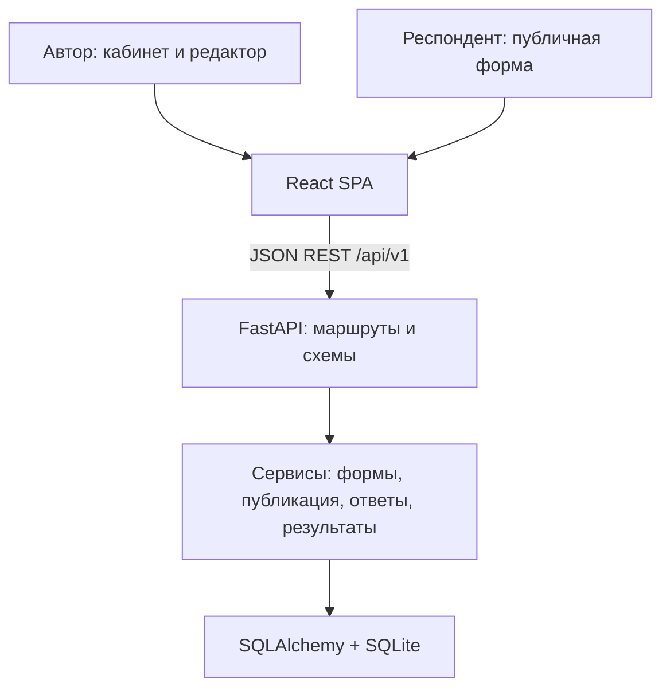
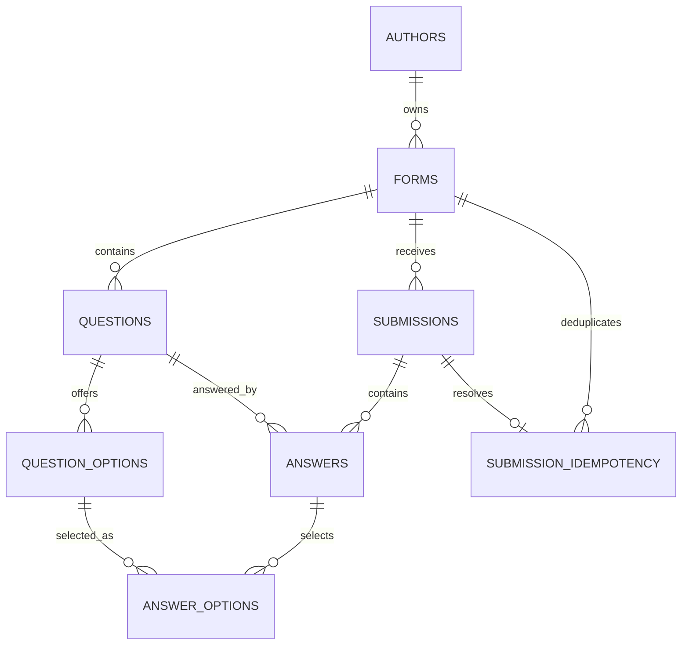

# Архитектура MVP: конструктор опросов и форм

Основание: `Кейс1_Конструктор_опросов_и_форм.pdf`, MerlionTech / НИЯУ МИФИ. Документ описывает проектируемую систему, а не реализованные функции.

## 1. Границы MVP

- **Автор** создаёт опрос, редактирует название, описание, состав и порядок вопросов, публикует форму и получает ссылку. В кабинете он видит свои формы, сводку и отдельные заполненные анкеты.
- **Респондент** без аккаунта открывает `/f/{slug}`, заполняет форму, получает подтверждение отправки. Публичная ссылка не даёт доступа к результатам.
- Типы вопросов: `text`, `single_choice`, `multiple_choice`, `rating`. Для оценки используются целые числа, диапазон настраивается, по умолчанию 1–5.
- **Решение для MVP:** `draft → published`. Черновик может быть незаполненным; публикация проверяет готовность всей формы. Опубликованные название, описание, вопросы и варианты неизменяемы. Это исключает смешивание статистики по разным формулировкам. Если редактирование уже опубликованных форм станет обязательным, следует ввести неизменяемые версии и привязывать анкеты к версии, а не снимать блокировку.
- Публикация по ссылке означает «доступно любому, у кого есть ссылка», а не приватность. Нет каталога форм, аккаунтов, ролей, ветвления, совместного редактирования, экспорта и запрета на повторное прохождение. После публикации форма продолжает принимать ответы; закрытие сбора вне MVP. Если форма содержит персональные данные, автор должен не использовать учебный стенд для реального сбора: политика хранения и удаления данных не входит в MVP.

## 2. Архитектура и технологии



Один репозиторий, один backend-процесс и одна БД. В production один origin для SPA и API: прокси раздаёт сборку React, маршруты SPA возвращают `index.html`, запросы `/api/` направляются в FastAPI. В разработке Vite проксирует `/api` к Uvicorn. Задачи аналитики выполняются по запросу SQL-агрегациями; очередь, кэш и отдельный сервис аналитики не нужны. Нужны healthcheck (`GET /healthz`) без доступа к данным и структурированные логи без cookie, токенов и тел анкет.

| Зона | Технологии и назначение |
| --- | --- |
| Backend | Python, FastAPI, Uvicorn, Pydantic: REST, схемы, валидация; синхронные обработчики для синхронной БД |
| Данные | SQLite, SQLAlchemy 2.x, Alembic: таблицы, транзакции, воспроизводимые миграции |
| Frontend | TypeScript, React, Vite, React Router; `fetch` и общий API-клиент для запросов и обработки ошибок |
| Графики | Горизонтальные столбцы для вариантов (можно на CSS); среднее и гистограмма для оценки. Свободный текст — в деталях анкет, без анализа текста |
| Контракт и качество | OpenAPI (`/openapi.json`), Swagger UI (`/docs`), pytest + FastAPI TestClient, Ruff, проверки TypeScript и сборка Vite, Git/GitHub Actions |

Предлагаемая структура:

```text
backend/
  app/
    main.py           # создание приложения, подключение маршрутов
    api/              # маршруты: private forms, public forms, results
    schemas/          # схемы запросов, ответов и ошибок
    services/         # бизнес-правила и границы транзакций
    db/               # модели, подключения и SQL-запросы
  migrations/
  tests/
frontend/
  src/
    api/              # клиент и типы контракта
    pages/            # кабинет, редактор, публичная форма, результаты
    components/       # поля вопросов, редактор вариантов, графики
```

Маршруты SPA: `/forms`, `/forms/{formId}/edit`, `/forms/{formId}/results`, `/forms/{formId}/results/{submissionId}`, `/f/{slug}`. Для опубликованной формы редактор показывает структуру в режиме чтения и позволяет скопировать ссылку.

## 3. Доступ без регистрации

Минимальное разделение авторов — анонимная сессия браузера, а не полноценная авторизация. При первом успешном `POST /forms` сервер создаёт автора и случайный непрозрачный токен сессии, если действующей сессии нет; в БД хранится только SHA-256-хеш токена (токен должен быть криптографически случайным, не UUID от клиента). Токен передаётся в cookie `HttpOnly; SameSite=Lax; Path=/api/v1`, в HTTPS-окружении также `Secure`. Срок жизни cookie и серверной сессии задаётся одной настройкой (например, 30 дней). На изменяющих авторских запросах сервер проверяет `Origin` относительно настроенного origin приложения, а production-конфигурация запрещает wildcard CORS. Это только прототип: для реального сервиса нужны email/OIDC-вход, восстановление доступа, logout/отзыв сессий и управление аккаунтом.

`GET /forms` без действующей сессии возвращает пустой список; остальные авторские запросы к конкретной форме без сессии — `401`, с чужим или неизвестным ID — `404`. Во всех запросах к результатам сервер проверяет владельца формы, а анкета ищется в пределах этой формы. `slug` — случайный уникальный URL-safe идентификатор, не секрет и не авторский ключ. Потеря cookie или истечение сессии означает потерю доступа к прежним формам; это ограничение прототипа нужно явно показать в интерфейсе. Публичные запросы не требуют авторской cookie.

## 4. REST API

Префикс всех маршрутов ниже: `/api/v1`. Запросы и ответы — JSON. Идентификаторы сущностей — UUID-строки, даты — ISO 8601 в UTC. Имена полей — `snake_case`.

| Метод и путь | Назначение | Успех |
| --- | --- | --- |
| `POST /forms` | Создать черновик; тело `{title, description?}` | `201`, представление формы и `Location` |
| `GET /forms?limit=20&offset=0` | Список своих форм: ID, заголовок, статус, даты, публичный путь после публикации | `200` |
| `GET /forms/{formId}` | Полная авторская схема, включая `revision`, статус, вопросы и варианты | `200` |
| `PUT /forms/{formId}` | Заменить редактируемые поля черновика целиком: `{revision, title, description, questions}`. Порядок задан массивами | `200`, обновлённая форма |
| `POST /forms/{formId}/publish` | Опубликовать черновик; тело `{revision}`. Вернуть статус, новую ревизию, `slug` и `public_path` | `200` |
| `GET /public/forms/{slug}` | Получить только опубликованную схему: название, описание, вопросы и настройки. Без данных автора и результатов | `200` |
| `POST /public/forms/{slug}/submissions` | Проверить и сохранить анкету целиком; обязательный `Idempotency-Key` позволяет повторить запрос без второй анкеты | `201` (или `200` для повторного идемпотентного запроса) |
| `GET /forms/{formId}/results/summary` | Количество анкет и агрегаты по вопросам опубликованной формы | `200` |
| `GET /forms/{formId}/submissions?limit=20&offset=0` | Список анкет: ID и время отправки | `200` |
| `GET /forms/{formId}/submissions/{submissionId}` | Одна анкета: ID, время, ответы; подписи берутся из неизменяемой схемы формы | `200` |

Списки возвращают `{items, total, limit, offset}`, `limit` от 1 до 100. Сортировка форм — `updated_at DESC, id DESC`, анкет — `submitted_at DESC, id DESC`. При одновременном добавлении строк offset-пагинация может смещаться; для MVP это допустимо. Публичный POST требует `Idempotency-Key` длиной 16–128 ASCII-символов: ключ хранится в отдельной таблице вместе с хешем тела запроса, статусом и результатом, имеет TTL (например, 24 часа), а повтор с тем же ключом и другим телом получает `409`. Это защищает от дубля при таймауте клиента; одно только отключение кнопки не защищает от повторного HTTP-запроса.

### Редактор и публикация

`POST /forms` создаёт форму с `revision=1` и пустым массивом вопросов. В `PUT` массивы `questions` и `options` определяют позиции с нуля; отсутствие ранее сохранённого элемента в полном запросе означает его удаление из черновика. Для новых вопросов и вариантов клиент генерирует UUID; сервер проверяет уникальность и принадлежность существующих ID. При смене типа несовместимые поля удаляются. Пример фрагмента тела `PUT` (UUID приведены для иллюстрации):

```json
{
  "revision": 1,
  "title": "Обратная связь по практикуму",
  "description": "Займёт две минуты",
  "questions": [
    {
      "id": "888ca6ad-bef3-46bc-9d5b-beb8fb2b1132",
      "type": "rating",
      "title": "Как вы оцените практикум?",
      "required": true,
      "rating_min": 1,
      "rating_max": 5
    }
  ]
}
```

`single_choice` и `multiple_choice` передают `options: [{id, label}, ...]`; у `text` нет ни вариантов, ни границ оценки. `PUT` и публикация проверяют `revision` и `draft` в одной транзакции с изменением и увеличивают ревизию на 1 при успехе. При конфликте интерфейс предлагает перезагрузить форму перед повтором, а не затирает чужое сохранение из другой вкладки. `PUT` разрешает пустые заголовки вопросов и незаполненные варианты в процессе работы; публикация требует хотя бы один вопрос, непустые заголовки формы и вопросов, минимум два непустых и различных после `trim` варианта у вопроса с выбором и корректные границы оценки. Повторная публикация уже опубликованной формы должна быть безопасным `409` с понятным кодом `form_already_published`, а не повторно генерировать `slug`.

### Отправка анкеты

```json
{
  "answers": [
    {
      "question_id": "888ca6ad-bef3-46bc-9d5b-beb8fb2b1132",
      "rating_value": 4
    }
  ]
}
```

У ответа ровно одно поле значения: `text_value` (строка), `option_ids` (массив UUID; ровно один для `single_choice`, один или больше для `multiple_choice`) или `rating_value` (строго целое число в диапазоне вопроса). Необязательный вопрос можно пропустить, не передавая его вовсе. Пустой после `trim` текст и пустой массив вариантов не считаются ответом и не принимаются. API отклоняет повторные `question_id`, повторные варианты, неизвестные вопросы и варианты не из данного вопроса, неверный тип значения и пропуск обязательного вопроса. Запись анкеты и всех её ответов атомарна. Каждый успешно обработанный POST создаёт анкету, кроме повторной доставки с тем же `Idempotency-Key`. Интерфейс отключает двойное нажатие и передаёт ключ, созданный до первого запроса; автоматический retry разрешён только с тем же ключом.

### Ошибки и лимиты

Единый формат, включая ошибки Pydantic: `{"error":{"code":"validation_error","message":"Проверьте ответы","details":[{"path":"answers.0.rating_value","code":"out_of_range"}]}}`. `401` — нет сессии автора; `403` — отклонён `Origin` или запрос запрещён политикой; `404` — нет доступного ресурса (в том числе публичной схемы черновика); `409` — конфликт ревизии, состояния или идемпотентности; `422` — ошибка тела запроса или правил публикации/ответа; `413` — превышен лимит тела; `429` — ограничена частота запросов. Для публичного API rate limit должен быть включён на production, а не оставлен только «если настроено».

Предлагаемые лимиты MVP, не требования кейса: заголовок формы 200 символов, описание 2 000, до 100 вопросов, заголовок вопроса 500, до 30 вариантов по 200 символов, текстовый ответ до 5 000 символов. Для оценки: `0 <= rating_min < rating_max <= 10`. Лимит HTTP-тела 8 МиБ на прокси; он не заменяет лимиты полей и массивов, которые проверяет API.

## 5. Модель SQLite



`PK` — первичный ключ, `FK` — внешний, `UQ` — уникальность. UUID и даты хранятся как `TEXT`; даты записываются единой UTC-строкой фиксированного формата. Все поля обязательны, кроме отмеченных `NULL`. `required` хранится как `INTEGER` (`0/1`).

| Таблица | Поля и ограничения |
| --- | --- |
| `authors` | `id PK`, `session_token_hash UQ`, `session_expires_at`, `created_at` |
| `forms` | `id PK`, `owner_id FK→authors.id`, `title`, `description`, `status` (`draft`/`published`), `revision INTEGER >= 1`, `slug NULL UQ`, `created_at`, `updated_at`, `published_at NULL`; черновик не имеет `slug` и времени публикации, у опубликованной формы заполнены оба |
| `questions` | `id PK`, `form_id FK→forms.id`, `type`, `title`, `required`, `position INTEGER >= 0`, `rating_min NULL`, `rating_max NULL`; `UQ(form_id, position)`, `UQ(id, form_id)`; границы заполнены и допустимы только для `rating` |
| `question_options` | `id PK`, `question_id FK→questions.id`, `label`, `position INTEGER >= 0`; `UQ(question_id, position)`, `UQ(id, question_id)` |
| `submissions` | `id PK`, `form_id FK→forms.id`, `submitted_at`; `UQ(id, form_id)`; повторная доставка определяется через отдельную `submission_idempotency` (см. ниже) |
| `answers` | `id PK`, `submission_id`, `form_id`, `question_id`, `text_value NULL`, `rating_value INTEGER NULL`; `UQ(submission_id, question_id)`, `UQ(id, question_id)`; оба значения не могут быть заполнены одновременно; для выбора оба `NULL` |
| `answer_options` | `answer_id`, `question_id`, `option_id`; составной `PK(answer_id, option_id)` |
| `submission_idempotency` | `form_id FK→forms.id`, `idempotency_key`, `request_hash`, `submission_id NULL`, `response_status`, `created_at`; `PK(form_id, idempotency_key)`, `UQ(submission_id, form_id)`, индекс/очистка по `created_at`; составной FK `(submission_id, form_id) → submissions(id, form_id)` |

Для `submission_idempotency` `submission_id` заполняется в той же транзакции, что и анкета; до завершения транзакции конкурентный запрос с тем же ключом блокируется или получает повтор результата после commit. Хеш тела нужен, чтобы тот же ключ нельзя было незаметно применить к другой анкете.

Ключевые составные FK (в скобках порядок колонок):

- `answers(submission_id, form_id) → submissions(id, form_id)` и `answers(question_id, form_id) → questions(id, form_id)` — нельзя записать ответ на вопрос другой формы.
- `answer_options(answer_id, question_id) → answers(id, question_id)` и `answer_options(option_id, question_id) → question_options(id, question_id)` — нельзя записать вариант от другого вопроса.

Составные `UQ` на родительских таблицах нужны SQLite для таких ссылок, хотя `id` сам по себе уникален. `CHECK` и `NOT NULL` обеспечивают локальные ограничения. В сервисе остаются межстрочные правила: тип значения соответствует вопросу, у одиночного выбора ровно один вариант, оценка в пределах вопроса, заполнены обязательные вопросы, анкеты принимаются только для опубликованной формы. Так как эти правила зависят от нескольких строк и состояния формы, нельзя считать одних SQL `CHECK` достаточной защитой: валидатор должен читать опубликованную схему в той же транзакции, которая создаёт анкету.

Индексы поверх `PK`/`UQ`: `forms(owner_id, updated_at DESC, id DESC)`, `submissions(form_id, submitted_at DESC, id DESC)`, `answers(question_id)`, `answer_options(option_id)`. Удаление вариантов при удалении вопроса черновика — `ON DELETE CASCADE` для `question_options.question_id`; ссылки на данные с ответами — `RESTRICT`, публичного удаления форм и анкет нет. Поскольку в черновике нет анкет, для `PUT` можно удалить старый набор вопросов и вставить новый со стабильными UUID в одной транзакции: это также исключает временные конфликты уникальных позиций при перестановке.

`PRAGMA foreign_keys=ON` — при открытии каждого соединения; `journal_mode=WAL` — при настройке файла БД; `busy_timeout` — на каждом соединении. Для записи держать короткие транзакции, при сохранении/публикации брать блокировку записи до чтения состояния (`BEGIN IMMEDIATE` либо эквивалентная реализация с условным `UPDATE`). Хранить файл БД на постоянном локальном томе и создавать резервные копии через SQLite Backup API. SQLite подходит для одного учебного инстанса; при необходимости нескольких инстансов с общей БД или высокой конкуренции записи — переход на PostgreSQL.

## 6. Аналитика

Общий объём — `COUNT` строк `submissions` формы, не количество строк в `answers`. Для каждого вопроса возвращаются `question_id`, `type`, `answered_count` и `skipped_count = total_submissions - answered_count`. Группировки выполняются раздельно, чтобы соединение с таблицей вариантов не размножало строки ответов.

| Тип | Агрегат и отображение |
| --- | --- |
| `text` | Число заполненных и пропущенных; сами тексты — только в деталях анкет |
| `single_choice`, `multiple_choice` | `options: [{option_id, count}]` в порядке формы; включить варианты с `count=0`. Доля при показе процентов: `count / answered_count`; у множественного выбора сумма долей может превышать 100% |
| `rating` | `average` по фактически оставленным оценкам, `distribution: [{value, count}]` по всему диапазону. При отсутствии значений среднее `null`, а не `0`; округление для отображения делает UI |

Для формы без анкет сводка сохраняет структуру вопросов, показывает нули и `average: null` для оценок. Рекомендуемая форма ответа: `{total_submissions, questions: [{question_id, type, answered_count, skipped_count, options?, average?, distribution?}]}`; `options` содержит также варианты с нулевым числом, `distribution` — весь диапазон оценки. Для графиков нужны текстовые числа и подписи, чтобы значения были доступны не только по цвету или наведению.

## 7. Реализация и критерии приёмки

1. **Основа:** поднять FastAPI и React, настроить `/api/v1`, миграции SQLite и сборку в GitHub Actions. Опубликовать схемы запросов и ответов через OpenAPI, согласовать их до параллельной работы над frontend и backend.
2. **Редактор:** сессия автора, список, создание, полное сохранение, изменение порядка, публикация. Проверка: незаполненная форма сохраняется как черновик, но не публикуется; устаревшая ревизия не перезаписывает данные; опубликованная структура неизменяема.
3. **Прохождение:** публичный экран и отправка всех четырёх типов. Проверка: черновик недоступен по публичному API; неизвестные ID и невалидные ответы не оставляют ни анкеты, ни части ответов в БД; валидная анкета сохраняется после перезапуска приложения.
4. **Результаты:** сводка, графики, список и детализация. Проверка: фиксированный набор анкет даёт ожидаемые нули, суммы и среднее; варианты из `multiple_choice` не увеличивают число анкет; чужой автор не видит ни сводку, ни отдельную анкету.
5. **Безопасность и демонстрация:** включить HTTPS, production rate limit на публичные GET/POST, CSP и запрет framing (`frame-ancestors 'none'`), ограниченный CORS, не логировать тела ответов, cookie и токены, не собирать реальные чувствительные данные в учебной демонстрации. Для анонимной авторской cookie достаточно `SameSite=Lax` только при одном origin; если frontend и API разводятся по site/origin, нужно явно добавить CSRF-токен и не полагаться на CORS как на CSRF-защиту. Сквозной сценарий: создать → опубликовать → открыть по ссылке → отправить → увидеть обновление сводки и анкету.

Минимум CI: `ruff check`, `ruff format --check`, `pytest`, проверка типов и production-сборка фронтенда. Интеграционные тесты API используют отдельную временную SQLite БД с применёнными миграциями и включёнными внешними ключами.
