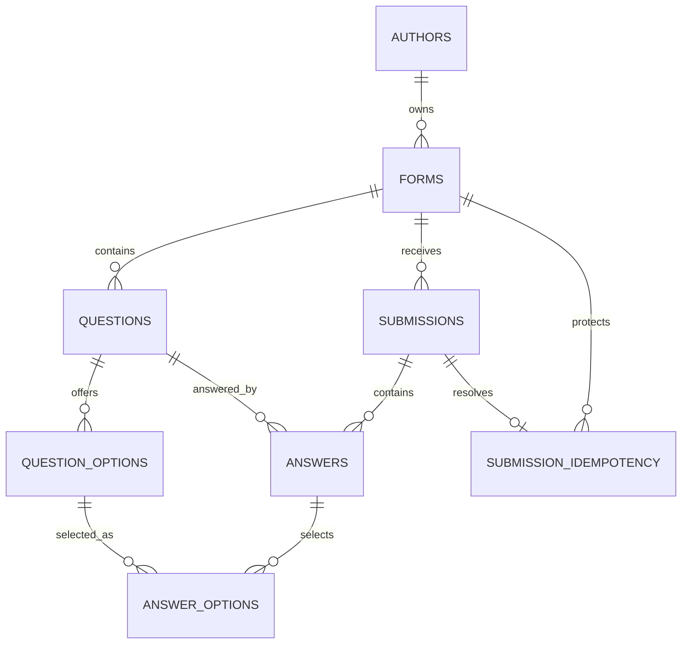

# Backend: база данных

Этот каталог содержит минимальный слой базы данных MVP. Сейчас в нём нет FastAPI-маршрутов, схем запросов и сервисов: реализованы модели SQLAlchemy, подключение SQLite и миграция Alembic.

Основная архитектура проекта описана в [`ARCHITECTURE.md`](../ARCHITECTURE.md). Этот файл объясняет, как соответствующая модель реализована в коде.

## 1. Быстрый запуск

Команды выполняются из каталога `backend`:

```bash
cd backend
python -m pip install -r requirements.txt
alembic upgrade head
```

После этого SQLite-файл `app.db` будет создан в текущем каталоге. Путь можно заменить через `DATABASE_URL`:

```bash
DATABASE_URL=sqlite:///./local.db alembic upgrade head
```

Проверить, что модель SQLAlchemy и применённые миграции не расходятся:

```bash
alembic check
```

Посмотреть текущую ревизию:

```bash
alembic current
```

Откатить последнюю миграцию в локальной базе:

```bash
alembic downgrade -1
```

> В production база должна находиться на постоянном диске. Файл SQLite, `-wal` и `-shm` не коммитятся в Git: это настроено в корневом [`.gitignore`](../.gitignore).

### Тесты базы данных

Из корня репозитория в активном виртуальном окружении:

```bash
python -m pip install -r backend/requirements-dev.txt
python -m pytest
```

Тесты находятся в [`backend/tests`](tests). Для каждого теста, которому нужна БД, [фикстуры](tests/conftest.py) создают отдельный временный SQLite-файл и применяют миграции Alembic. Настраивать `DATABASE_URL` или запускать `alembic upgrade head` перед тестами не нужно; локальная `app.db` не используется.

## 2. Карта файлов

| Файл | Назначение |
| --- | --- |
| [`app/db/base.py`](app/db/base.py) | Общий `DeclarativeBase`, генерация UUID и UTC-времени. |
| [`app/db/session.py`](app/db/session.py) | Создание SQLAlchemy Engine, настройки SQLite и фабрика сессий. |
| [`app/db/models/__init__.py`](app/db/models/__init__.py) | Импорт всех моделей, чтобы SQLAlchemy зарегистрировал их в общей metadata. |
| [`app/db/models/authors.py`](app/db/models/authors.py) | Таблица `authors`. |
| [`app/db/models/forms.py`](app/db/models/forms.py) | Таблицы `forms`, `questions`, `question_options` и индексы редактора. |
| [`app/db/models/responses.py`](app/db/models/responses.py) | Таблицы `submissions`, `answers`, `answer_options`, `submission_idempotency` и индексы результатов. |
| [`app/db/__init__.py`](app/db/__init__.py) | Удобный публичный импорт моделей и подключения. |
| [`migrations/env.py`](migrations/env.py) | Подключение Alembic к `Base.metadata` и к выбранной SQLite-БД. |
| [`migrations/versions/0001_initial_schema.py`](migrations/versions/0001_initial_schema.py) | Воспроизводимое создание всей схемы БД. |
| [`alembic.ini`](alembic.ini) | Настройка расположения миграций и URL по умолчанию. |
| [`requirements.txt`](requirements.txt) | Минимальные зависимости слоя БД: SQLAlchemy и Alembic. |

Разбиение моделей сделано намеренно: файл с моделями формы не содержит модели ответов, а файл с ответами не содержит модели автора. При этом внешний импорт остаётся простым:

```python
from app.db import Form, Question, SessionLocal
```

Этот экспорт находится в [`app/db/__init__.py`](app/db/__init__.py).

## 3. Как код запускает базу

### 3.1. Общая metadata

[`Base`](app/db/base.py#L29-L32) — общий декларативный базовый класс SQLAlchemy. Все модели наследуются от него. Поэтому их таблицы и ограничения попадают в один объект `Base.metadata`.

Модели импортируются в [`app/db/models/__init__.py`](app/db/models/__init__.py). Это важно для Alembic: если модель не импортирована до чтения `Base.metadata`, Alembic не увидит её и не сможет сравнить схему.

### 3.2. UUID и даты

Функция [`new_uuid`](app/db/base.py#L19-L21) генерирует UUID на стороне приложения. Клиент не передаёт идентификатор как источник случайности.

Функция [`utc_now`](app/db/base.py#L24-L26) возвращает фиксированную строку UTC вида:

```text
2026-11-23T12:34:56.123456Z
```

UUID и даты хранятся в SQLite как текстовые значения. Одинаковый формат дат позволяет сортировать даты лексикографически и не смешивать локальное время с UTC.

Значения `default=new_uuid` и `default=utc_now` являются Python-default SQLAlchemy. Они срабатывают при вставке через ORM/SQLAlchemy. Миграция при этом остаётся явной: она создаёт обязательные колонки, а бизнес-слой передаёт значения.

### 3.3. Создание Engine

Основной код находится в [`create_db_engine`](app/db/session.py#L25-L34). При SQLite-подключении он регистрирует обработчик [`_configure_sqlite_connection`](app/db/session.py#L14-L22), который выполняется для каждого нового соединения.

Обработчик включает:

```sql
PRAGMA foreign_keys = ON;
PRAGMA journal_mode = WAL;
PRAGMA busy_timeout = 5000;
```

Зачем это нужно:

- `foreign_keys = ON` — SQLite по умолчанию может не проверять внешние ключи. Без этого составные связи и `ON DELETE` не защищают данные.
- `journal_mode = WAL` — чтение меньше блокирует запись и база лучше ведёт себя при параллельной работе одного backend-процесса.
- `busy_timeout = 5000` — короткое ожидание снятия блокировки вместо мгновенной ошибки `database is locked`.

Глобальные [`DATABASE_URL`, `engine` и `SessionLocal`](app/db/session.py#L37-L39) создаются при импорте модуля. URL берётся из переменной окружения `DATABASE_URL`, а по умолчанию используется `sqlite:///./app.db`.

### 3.4. Сессия

[`get_session`](app/db/session.py#L42-L45) выдаёт короткоживущую SQLAlchemy-сессию и закрывает её после использования. Функция **не делает автоматический commit**. Граница транзакции должна быть видна в вызывающем сервисе:

```python
with SessionLocal() as session:
    with session.begin():
        # несколько связанных INSERT/UPDATE
        ...
```

Это важно для отправки анкеты: `submission`, `answers` и `answer_options` должны либо сохраниться все, либо откатиться все.

## 4. Таблицы и модели

Связи между сущностями:



### 4.1. `authors`

Модель [`Author`](app/db/models/authors.py#L14-L24) хранит анонимную авторскую сессию.

| Колонка | Назначение |
| --- | --- |
| `id` | UUID автора, первичный ключ. |
| `session_token_hash` | Хеш cookie-токена, уникальный. Сам токен в БД не хранится. |
| `session_expires_at` | Срок действия сессии в UTC-строке. |
| `created_at` | Время создания автора. |

Связь `Author.forms` означает, что один автор владеет несколькими формами. Хеширование токена, создание cookie и проверка срока действия относятся к сервисному/API-слою, а не к модели БД.

### 4.2. `forms`

Модель [`Form`](app/db/models/forms.py#L15-L55) — корневая сущность редактора и публичной формы.

| Колонка | Назначение |
| --- | --- |
| `id` | UUID формы, первичный ключ. |
| `owner_id` | Внешний ключ на `authors.id`. |
| `title` | Название формы. Обязательное поле. |
| `description` | Описание формы. Пустая строка допустима, `NULL` — нет. |
| `status` | Только `draft` или `published`. |
| `revision` | Номер ревизии, целое число не меньше `1`. |
| `slug` | Уникальный публичный идентификатор; `NULL` у черновика. |
| `created_at` | Время создания. |
| `updated_at` | Время последнего изменения через ORM. |
| `published_at` | Время публикации; `NULL` у черновика. |

Локальное состояние публикации защищено `CHECK` в [`Form.__table_args__`](app/db/models/forms.py#L18-L33):

- черновик обязан иметь `slug IS NULL` и `published_at IS NULL`;
- опубликованная форма обязана иметь и `slug`, и `published_at`.

Это не заменяет проверку готовности формы. Бизнес-слой дополнительно должен проверить, что есть вопросы, заполнены названия и настроены варианты до изменения статуса на `published`.

Связи `Form.questions` и `Form.submissions` описаны в той же модели. Сортировка списка форм ускоряется индексом `owner_id, updated_at DESC, id DESC` в нижней части [`forms.py`](app/db/models/forms.py#L133-L139).

### 4.3. `questions`

Модель [`Question`](app/db/models/forms.py#L57-L101) хранит вопрос внутри формы.

Допустимые типы задаются `CHECK`:

- `text` — свободный текст;
- `single_choice` — один вариант;
- `multiple_choice` — несколько вариантов;
- `rating` — целая оценка в диапазоне.

`required` хранится как `INTEGER` со значением `0` или `1`. `position` начинается с `0`. У одной формы не может быть двух вопросов с одинаковой позицией благодаря `UQ(form_id, position)`.

Для `rating` оба значения `rating_min` и `rating_max` обязательны, целые и удовлетворяют `rating_min <= rating_max`. Для остальных типов оба поля должны быть `NULL`. Это локальное правило находится в `ck_questions_rating_bounds`.

Составная уникальность `UQ(id, form_id)` нужна не для обычного поиска по UUID, а для SQLite: она позволяет на неё ссылаться составным внешним ключом из `answers`.

### 4.4. `question_options`

Модель [`QuestionOption`](app/db/models/forms.py#L104-L130) хранит варианты для вопросов выбора.

- `question_id` ссылается на вопрос;
- `position` неотрицательная и уникальна внутри вопроса;
- `id` дополнительно уникален вместе с `question_id`, чтобы на пару ссылались составные внешние ключи;
- удаление вопроса каскадно удаляет его варианты через `ON DELETE CASCADE`.

Модельная связь `Question.options` использует `cascade="all, delete-orphan"`. Это поведение ORM для работы с объектами; параллельно в самой SQLite-схеме есть SQL-ограничение `ON DELETE CASCADE`.

### 4.5. `submissions`

Модель [`Submission`](app/db/models/responses.py#L18-L40) — одна отправленная анкета.

| Колонка | Назначение |
| --- | --- |
| `id` | UUID анкеты, первичный ключ. |
| `form_id` | Форма, для которой отправлена анкета. |
| `submitted_at` | Время отправки. |

Анкеты не должны удаляться публичным API. Внешний ключ на форму использует `RESTRICT`, поэтому удаление формы с анкетами невозможно на уровне БД.

Индекс `form_id, submitted_at DESC, id DESC` поддерживает сортировку списка анкет так, как она описана в REST-контракте.

### 4.6. `answers`

Модель [`Answer`](app/db/models/responses.py#L42-L76) хранит ответ на один вопрос в одной анкете.

| Колонка | Назначение |
| --- | --- |
| `id` | UUID ответа, первичный ключ. |
| `submission_id` | Идентификатор анкеты. |
| `form_id` | Дублируется для проверки принадлежности составным FK. |
| `question_id` | Идентификатор вопроса. |
| `text_value` | Текстовый ответ или `NULL`. |
| `rating_value` | Целая оценка или `NULL`. |

Ограничения:

- `UQ(submission_id, question_id)` — на вопрос нельзя записать два ответа в одной анкете;
- `UQ(id, question_id)` — родительская уникальность для `answer_options`;
- `text_value` и `rating_value` нельзя заполнять одновременно;
- `rating_value`, если заполнен, обязан быть целым.

Для вопросов выбора оба значения остаются `NULL`, а выбранные варианты записываются в `answer_options`. Это специально оставлено как межстрочное правило сервиса: только сервис знает тип вопроса и должен проверить, что для `single_choice` выбран ровно один вариант.

### 4.7. `answer_options`

Модель [`AnswerOption`](app/db/models/responses.py#L79-L100) связывает ответ с выбранным вариантом.

Её первичный ключ — `(answer_id, option_id)`, как в архитектуре. `question_id` не входит в PK, но хранится в строке, чтобы работали составные внешние ключи:

```text
(answer_id, question_id) -> answers(id, question_id)
(option_id, question_id) -> question_options(id, question_id)
```

Благодаря этому нельзя:

- добавить вариант другого вопроса к ответу;
- добавить вариант к ответу с несовпадающим `question_id`;
- удалить вопрос или вариант, если на него уже ссылаются сохранённые ответы.

Индекс `answer_options(option_id)` нужен для подсчёта статистики по вариантам.

### 4.8. `submission_idempotency`

Модель [`SubmissionIdempotency`](app/db/models/responses.py#L103-L132) хранит ключ повторной доставки запроса.

| Колонка | Назначение |
| --- | --- |
| `form_id` | Форма; входит в первичный ключ и отдельно ссылается на `forms.id`. |
| `idempotency_key` | Ключ из HTTP-запроса; вместе с `form_id` уникален. |
| `request_hash` | Хеш тела запроса. |
| `submission_id` | Созданная анкета; `NULL`, пока операция не завершилась. |
| `response_status` | HTTP-статус сохранённого результата. |
| `created_at` | Время создания записи для TTL-очистки. |

Первичный ключ — `(form_id, idempotency_key)`. Поэтому два параллельных запроса с одним ключом формы не могут успешно создать две записи. `UQ(submission_id, form_id)` не позволяет привязать одну анкету к нескольким ключам одной формы.

Правильный сценарий сервиса:

1. начать короткую транзакцию с блокировкой записи;
2. найти строку по `(form_id, idempotency_key)`;
3. если она уже завершена — сравнить `request_hash` и вернуть сохранённый результат либо `409`;
4. если строки нет — создать запись и сохранить хеш тела;
5. проверить опубликованную схему формы;
6. вставить `submissions`, `answers`, `answer_options`;
7. записать `submission_id` и статус в ту же транзакцию;
8. выполнить `commit`.

Фоновая очистка старых ключей в MVP не реализована. Для неё есть индекс по `created_at` в [`responses.py`](app/db/models/responses.py#L135-L144).

## 5. Внешние ключи и границы проверки

### 5.1. Составные внешние ключи

SQLite требует, чтобы набор колонок, на который ссылается составной FK, был первичным ключом или имел точный `UNIQUE`. Поэтому в родительских таблицах присутствуют дополнительные уникальности:

- `questions(id, form_id)`;
- `question_options(id, question_id)`;
- `submissions(id, form_id)`;
- `answers(id, question_id)`.

Главные связи объявлены непосредственно в моделях `Answer`, `AnswerOption` и `SubmissionIdempotency`, а в SQL-выражениях миграции находятся в [`0001_initial_schema.py`](migrations/versions/0001_initial_schema.py#L144-L223).

### 5.2. Что проверяет БД

SQLite сама проверяет:

- наличие связанных авторов, форм, вопросов, вариантов и анкет;
- уникальность идентификаторов, позиций и idempotency-ключей;
- допустимый тип вопроса;
- диапазон и тип локальных числовых полей;
- согласованность `draft/published`;
- несовместимость `text_value` и `rating_value`;
- принадлежность ответа и варианта одной форме и одному вопросу;
- запрет удаления данных, на которые уже ссылаются ответы.

### 5.3. Что проверяет сервисный слой

База не должна пытаться решать правила, которые требуют чтения нескольких строк или текущего состояния формы. Сервис обязан проверить:

- анкета отправляется только опубликованной форме;
- все обязательные вопросы заполнены;
- текст не пустой после нормализации;
- тип значения соответствует типу вопроса;
- для `single_choice` выбран ровно один вариант;
- для `multiple_choice` нет дубликатов вариантов;
- все выбранные варианты принадлежат вопросу;
- рейтинг попадает в `rating_min..rating_max`;
- опубликованная структура не изменяется;
- ревизия из запроса не устарела;
- повторный idempotency-ключ использует тот же `request_hash`.

Проверка схемы формы и вставка анкеты должны проходить в одной транзакции. Иначе форма может измениться между чтением вопроса и записью ответа.

## 6. Миграции Alembic

### 6.1. Как Alembic видит модели

[`migrations/env.py`](migrations/env.py#L11-L23) добавляет `backend` в `sys.path`, импортирует `Base` и пакет моделей, а затем передаёт `Base.metadata` Alembic.

Есть два режима:

- [`run_migrations_offline`](migrations/env.py#L26-L38) — генерирует SQL без подключения к БД;
- [`run_migrations_online`](migrations/env.py#L41-L55) — создаёт настроенный Engine и применяет операции к SQLite.

URL берётся сначала из `DATABASE_URL`, затем из `sqlalchemy.url` в [`alembic.ini`](alembic.ini).

### 6.2. Начальная миграция

[`0001_initial_schema.py`](migrations/versions/0001_initial_schema.py#L18-L241) создаёт таблицы в порядке зависимостей:

1. `authors`;
2. `forms`;
3. `questions`;
4. `question_options`;
5. `submissions`;
6. `answers`;
7. `answer_options`;
8. `submission_idempotency`;
9. индексы.

Откат в [`downgrade`](migrations/versions/0001_initial_schema.py#L244-L259) удаляет индексы и таблицы в обратном порядке.

Миграция является источником истины для существующей базы. `Base.metadata.create_all()` можно использовать в изолированном тесте, но не следует использовать вместо Alembic в общем окружении: `create_all()` не управляет изменениями уже существующей схемы.

### 6.3. Как добавить изменение схемы

1. Изменить нужную модель в одном из файлов [`app/db/models`](app/db/models).
2. Убедиться, что модель импортируется через [`models/__init__.py`](app/db/models/__init__.py).
3. Создать миграцию:

   ```bash
   cd backend
   alembic revision --autogenerate -m "describe the schema change"
   ```

4. Обязательно открыть сгенерированный файл и проверить SQL вручную. Для SQLite операции с ограничениями могут требовать аккуратной пересборки таблицы.
5. Применить миграцию к тестовой БД:

   ```bash
   alembic upgrade head
   ```

6. Проверить модель и миграцию:

   ```bash
   alembic check
   ```

7. Добавить проверку нового ограничения или индекса до перехода к API.

Не изменяйте уже применённую миграцию вместо создания новой, если база могла попасть к другому разработчику или в окружение.

## 7. Транзакции в будущих сервисах

Слой базы данных предоставляет соединение и ограничения, но не содержит бизнес-сервисов. Планируемые операции должны иметь такие границы:

### Сохранение черновика

- открыть короткую транзакцию;
- получить блокировку записи до чтения текущей ревизии (`BEGIN IMMEDIATE` или эквивалент);
- проверить `revision` из запроса;
- обновить форму;
- заменить набор вопросов и вариантов;
- увеличить ревизию;
- зафиксировать изменения.

Для черновика допускается удалить старый набор вопросов и вставить новый в одной транзакции. Это не оставляет промежуточного состояния для читателя и позволяет безопасно менять позиции.

### Публикация

- получить форму с блокировкой записи;
- проверить ревизию и статус `draft`;
- загрузить вопросы и варианты;
- выполнить полную проверку готовности;
- создать уникальный `slug`;
- обновить `status`, `published_at`, `revision`;
- зафиксировать всё одной транзакцией.

После публикации API не должен менять название, описание, вопросы и варианты. База фиксирует только согласованность полей статуса; запрет редактирования должен находиться в сервисном слое.

### Отправка анкеты

- открыть транзакцию;
- получить опубликованную форму и её структуру;
- проверить ответы;
- вставить все строки анкеты;
- сохранить результат idempotency;
- выполнить commit.

Любая ошибка валидации или внешнего ключа должна откатить всю транзакцию. В базе не должно остаться анкеты без полного набора допустимых ответов.

## 8. Аналитика поверх этой схемы

Общее число прохождений считается по `COUNT(*)` таблицы `submissions`, а не по `answers`: у одной анкеты может быть несколько ответов и несколько `answer_options`.

Для сводки нужно:

- сначала получить все вопросы опубликованной формы в порядке `position`;
- отдельно посчитать число анкет формы;
- для каждого вопроса посчитать заполненные ответы;
- вычислить `skipped_count = total_submissions - answered_count`;
- для вариантов соединять `answer_options` с `question_options`, не умножая строки `submissions`;
- включать варианты с нулевым количеством;
- для рейтинга строить распределение по всему диапазону и возвращать `average: null`, если оценок нет.

Индексные заготовки для этих запросов находятся в [`forms.py`](app/db/models/forms.py#L133-L139) и [`responses.py`](app/db/models/responses.py#L135-L144). SQL-запросы аналитики пока не добавлены, потому что они относятся к будущему сервисному слою результатов.

## 9. Частые проблемы

### `no such table`

Миграции не применены к используемому URL. Проверьте `DATABASE_URL` и выполните:

```bash
cd backend
alembic upgrade head
```

### `database is locked`

Проверьте, что приложение не держит долгую транзакцию, используется [`create_db_engine`](app/db/session.py#L25-L34), а файл лежит на локальном постоянном диске. `busy_timeout` помогает с короткими конфликтами, но не заменяет короткие транзакции.

### Внешний ключ не срабатывает

Соединение, вероятно, создано напрямую через `sqlite3` или другой Engine без обработчика из [`session.py`](app/db/session.py#L14-L34). Для каждого соединения нужен `PRAGMA foreign_keys = ON`.

### `alembic check` показывает изменения

Проверьте, что:

1. новая модель импортируется в [`models/__init__.py`](app/db/models/__init__.py);
2. используется правильный `DATABASE_URL`;
3. последняя миграция действительно применена (`alembic current`);
4. изменение модели не требует новой миграции.

### Нельзя удалить форму

Это ожидаемо, если на неё ссылаются вопросы или анкеты. Для данных, участвующих в ответах, используется `RESTRICT`, чтобы не разрушить историю результатов.

## 10. Границы текущего MVP

В этом слое намеренно отсутствуют:

- HTTP API и FastAPI dependency;
- Pydantic-схемы;
- проверка cookie и прав владельца;
- сервисы публикации и отправки анкеты;
- SQL-запросы сводной аналитики;
- планировщик очистки старых idempotency-ключей;
- резервное копирование через SQLite Backup API.

Это не пропущенные части схемы: они относятся к следующим слоям архитектуры. При добавлении API нужно сохранить описанные транзакционные границы и не переносить межстрочную бизнес-валидацию только в `CHECK`-ограничения.
